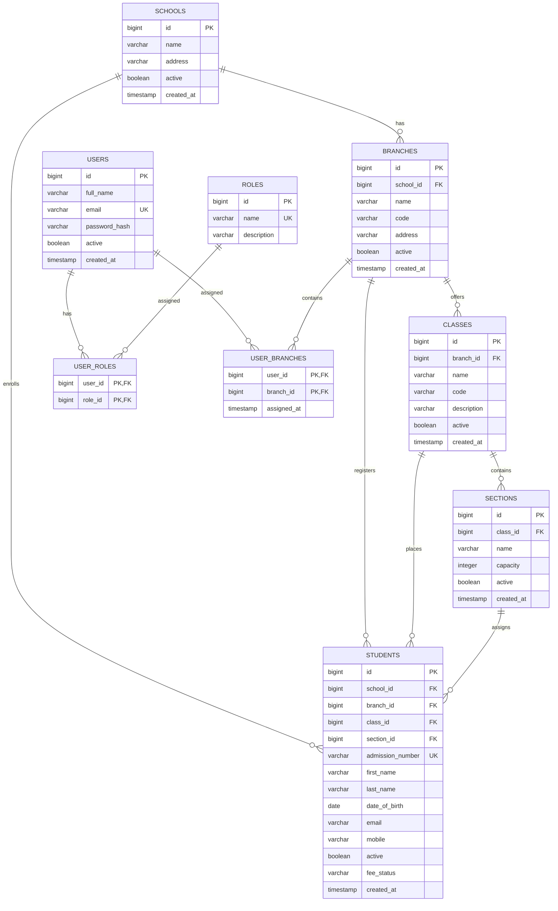

# School ERP - Entity Relationship Diagram

Student admission numbers are unique within a school (`school_id`, `admission_number`).
Student fee status is `PAID` or `UNPAID`; the migration defaults existing and new records to `UNPAID`.
