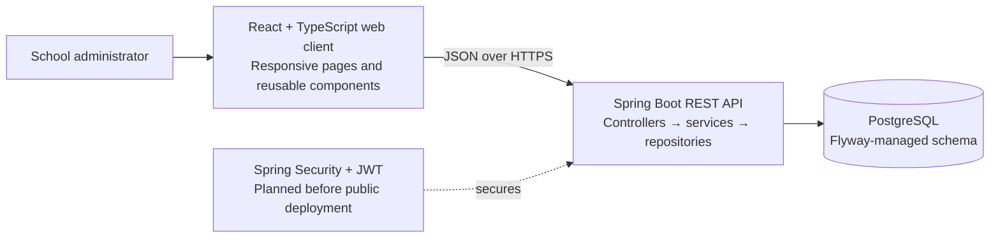

# School ERP UI Architecture and Implementation Plan

**Project:** MASHCOD School ERP  
**Scope:** Current school administration features: school, branches, classes, sections, students, and simple paid/unpaid fee status  
**Prepared:** 3 November 2026

## 1. Product direction

Build a responsive administrator workspace for a single school installation with one or more branches. The main workflow is:

1. Set up a branch.
2. Create classes and their sections.
3. Register and place students in a branch, class, and section.
4. Review the paid/unpaid fee status and update a student's status.

The dashboard should make student counts, unpaid fee follow-up, and common school setup actions easy to find. Keep this first release focused on administration. Attendance, staff, examinations, fee schedules, and parent portals are future modules and are shown as planned areas only.

## 2. UI prototype included

`frontend/prototype/index.html` is a responsive, dependency-free dashboard prototype. It includes:

- Sidebar navigation for Overview, Students, Classes & sections, and Fee status.
- Overview cards for student counts, paid/unpaid status, classes, and sections.
- Recent student list and quick actions.
- Student search and class/section filters.
- Class cards with section counts.
- Unpaid student list with a local prototype action to mark a student paid.
- Responsive layout and a generated campus photograph at `frontend/prototype/assets/school-campus.png`.

The prototype uses synthetic in-browser data and does not call the Spring API. Add a real form and API connection during the implementation phases below. The sample photo is illustrative and is not a photograph of the actual school.

## 3. Proposed application architecture



The production UI should be a separate React + TypeScript client. It should call the existing versioned REST API through a small typed API layer. Keep rendering, API calls, and business rules separate. The Spring service layer remains responsible for branch/class/section placement validation and fee status changes.

### Proposed frontend structure

```text
frontend/
  src/
    app/                 routes, layout, navigation
    components/          tables, forms, status pills, dialogs
    features/
      dashboard/         overview metrics and recent students
      students/          list, create/edit form, placement filters
      classes/           class and section management
      fees/              summary, unpaid list, status update
    lib/                 API client, query cache, formatters
    types/               API request and response types
```

Use a shared shell with a left navigation rail, school/branch context, page title, action area, and content region. On narrow screens, collapse the rail into a menu. Tables should become horizontally scrollable or switch to stacked cards on phones. Use visible labels, keyboard focus states, accessible contrast, and status text in addition to color.

### Backend boundaries

```text
Browser
  └── REST controllers (request validation, HTTP contract)
      └── services (business rules and transactions)
          └── repositories (queries)
              └── JPA entities / PostgreSQL

Flyway migrations own schema changes; Hibernate remains in validate mode.
```

Do not duplicate placement or fee rules in the client. The client may guide the user with dependent branch → class → section selectors, but the server must continue to verify that the chosen section belongs to the chosen class and that the class belongs to the branch.

## 4. Page and route map

| UI page | Main content | API calls |
|---|---|---|
| Overview | Student, paid, unpaid, class, and section counts; recent students; shortcuts | `GET /api/v1/students`, `GET /api/v1/students/fees/summary`, `GET /api/v1/classes?branchId={id}`, `GET /api/v1/sections?classId={id}` |
| Students | Search, class/section filters, student table, create/edit form | `GET/POST /api/v1/students`, `GET/PUT /api/v1/students/{id}`, `PATCH /api/v1/students/{id}/status` |
| Class & section setup | Class list by branch, sections within class, create/edit/deactivate | `/api/v1/classes`, `/api/v1/classes/{classId}/students`, `/api/v1/sections?classId={id}` and their create/update/status routes |
| Class roster | Students in one class or section | `GET /api/v1/classes/{classId}/students`, `GET /api/v1/classes/{classId}/sections/{sectionId}/students` |
| Fee status | Paid/unpaid totals and unpaid roster; mark paid/unpaid | `GET /api/v1/students/fees/summary`, `GET /api/v1/students/fees/unpaid`, `PATCH /api/v1/students/{id}/fee-status?status={PAID\|UNPAID}` |

### Key forms

**Student form:** admission number, first name, last name, date of birth, email, mobile, branch, class, section, and fee status. Load class options after branch selection and section options after class selection. Show field-level validation and a clear error when placement IDs do not match.

**Class form:** branch, class name, optional code, and description. **Section form:** parent class, section name, optional capacity. Confirm before deactivation and explain that deactivation does not delete records.

## 5. Current functional limits to account for

- The backend is a single-school installation. Branch selection is still required for class and student placement.
- Fee status is a simple `PAID`/`UNPAID` value. There are no fee plans, amounts, due dates, receipts, or payment transactions yet.
- The current security configuration permits all requests for development. Add login, JWT, role checks, and branch-level authorization before exposing real student data publicly.
- Student list and fee summary endpoints currently use the backend's implemented response shapes; keep the frontend API types aligned with OpenAPI and update them when pagination or filters change.
- The included HTML prototype uses synthetic data and local interactions only. It is a visual/flow prototype, not a deployed or API-connected frontend.

## 6. Implementation plan

### Phase 0 — API and data contract

- Freeze the request/response shape for students, class, section, fee summary, and rosters.
- Review OpenAPI output and confirm all frontend-needed fields are represented in DTOs.
- Add server-side pagination/filtering for student roster and unpaid lists before production-scale datasets.
- Decide whether inactive students appear in dashboard metrics and unpaid follow-up; document the rule.

**Done when:** page requirements map to stable, documented API contracts and the development database has representative sample data.

### Phase 1 — Frontend foundation and shell

- Create the React + TypeScript app and shared design tokens.
- Add responsive navigation, page shell, loading, empty, error, and toast patterns.
- Add typed API client with configurable API base URL.

**Done when:** routes render consistently on desktop and mobile, with clear loading and error states.

### Phase 2 — Classes and sections

- Build class list by branch and class create/edit/deactivate flows.
- Build section list by class and section create/edit/deactivate flows.
- Add duplicate and missing-parent error handling.

**Done when:** administrators can set up academic structure without entering raw IDs.

### Phase 3 — Student administration

- Build student list, search, class/section filters, and class/section rosters.
- Add student registration and update forms with dependent selectors.
- Add active/inactive status control and clear placement validation messages.

**Done when:** the UI can complete student CRUD and rosters reflect the selected class/section.

### Phase 4 — Fee status

- Build paid/unpaid summary cards and unpaid student list.
- Add an explicit confirmation before changing a fee status.
- Update counts and list state after a successful API response; handle failures without optimistic data loss.

**Done when:** staff can review outstanding students and mark a status, with the updated server response reflected in the UI.

### Phase 5 — Authentication and authorization

- Replace development allow-all security with login and token validation.
- Enforce role permissions and branch-scoped access in the backend.
- Add client session handling, protected routes, and sign-out behavior.

**Done when:** anonymous access is rejected and a user cannot view or change records outside their authorization scope.

### Phase 6 — Quality and release readiness

- Add component/API integration tests and accessibility checks.
- Verify responsive behavior at phone, tablet, and desktop widths.
- Add environment-based API configuration and production build/deployment instructions.
- Keep OpenAPI, API examples, and the UI architecture documentation current.

**Done when:** core flows pass repeatable checks, production secrets are externalized, and release setup is documented.

## 7. Suggested delivery order

Deliver one usable vertical slice at a time: (1) shell + classes/sections, (2) student registration and roster, (3) fee summary and unpaid follow-up, (4) auth and branch authorization, (5) hardening and deployment. Keep the prototype in `frontend/prototype/` as a visual reference until the production React client replaces it.
